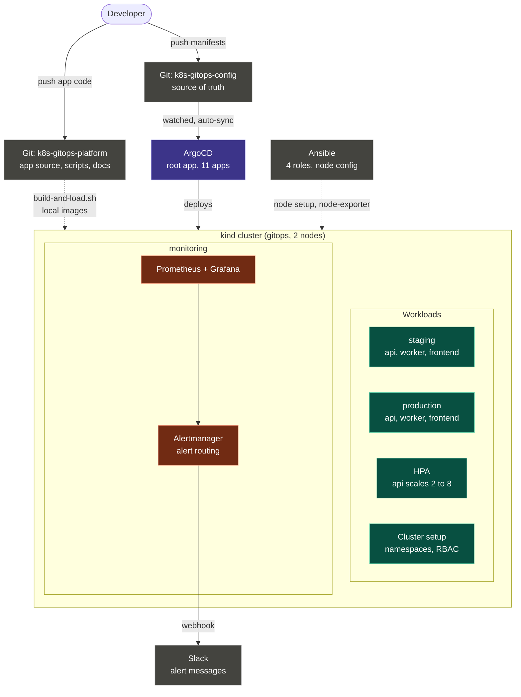

# GitOps Platform on Kubernetes

A GitOps-driven deployment platform for a three-service demo application ("Task Manager"), built with **Kubernetes, Helm, ArgoCD, Ansible, Prometheus and Grafana**. The whole platform runs locally on a **kind** cluster. Everything that runs in the cluster is declared in Git and reconciled automatically by ArgoCD.

> College capstone project, DevOps Institute Mumbai.

**Demo video (3 min):** [Watch here](https://example.com/replace-with-demo-video)

---

## Table of contents

1. [Highlights](#highlights)
2. [Architecture](#architecture)
3. [Specifications](#specifications)
4. [Repositories](#repositories)
5. [Repository layout](#repository-layout)
6. [The application](#the-application)
7. [Prerequisites](#prerequisites)
8. [Quick start](#quick-start)
9. [Accessing the services](#accessing-the-services)
10. [Helm charts](#helm-charts)
11. [GitOps with ArgoCD](#gitops-with-argocd)
12. [Autoscaling (HPA)](#autoscaling-hpa)
13. [Monitoring and alerting](#monitoring-and-alerting)
14. [Ansible](#ansible)
15. [RBAC and namespaces](#rbac-and-namespaces)
16. [Demo walkthrough](#demo-walkthrough)
17. [Troubleshooting and lessons learned](#troubleshooting-and-lessons-learned)
18. [Known limitations](#known-limitations)
19. [Documentation](#documentation)

---

## Highlights

- **3 microservices** (`api`, `worker`, `frontend`), each with its own Helm chart.
- **ArgoCD app-of-apps**: one root application discovers and manages **11 child applications**, with automated sync, prune, self-heal and retry. No applications are created from the UI.
- **Two environments**, `staging` and `production`, in separate namespaces with RBAC.
- **HPA** on the `api` service scaling **2 to 8 replicas** (CPU 70%, memory 80%), verified under load.
- **Monitoring**: kube-prometheus-stack with two provisioned Grafana dashboards and four alert rules, Alertmanager configured to route to Slack.
- **Ansible**: four roles for node setup, node-exporter and monitoring config, with a dynamic AWS EC2 inventory.
- **Terraform** for an EKS cluster is written (not applied; the project runs on kind).

---

## Architecture



**Flow in one line:** a developer pushes to `k8s-gitops-config`, ArgoCD detects the change, syncs it to the cluster, and Prometheus/Grafana/Alertmanager observe the result.

---

## Specifications

### Environment

| Item | Value |
|---|---|
| Host OS | Windows with VMware Workstation (NAT networking) |
| Guest OS | Ubuntu 24.04 VM (IP `192.168.40.130`) |
| Cluster | kind, name `gitops`, 2 nodes |
| Kubernetes | v1.37.0 |
| Ingress | ingress-nginx (kind maps ingress to host port `9080`) |
| Metrics | metrics-server |

### Components

| Component | Version / detail |
|---|---|
| ArgoCD | Helm chart `10.18.3` (app v3.6.2) |
| kube-prometheus-stack | Helm chart `69.8.2` |
| Application runtime | Python 3.12 (FastAPI) |
| node-exporter (Ansible role) | v1.8.2 as a systemd service |
| Container images | `api:v1.0.0`, `worker:v1.0.0`, `frontend:v1.0.0` (local, loaded into kind) |

### Services

| Service | Port | Role |
|---|---|---|
| `api` | 8000 | FastAPI task API (in-memory tasks) |
| `worker` | 8001 | Exposes metrics, calls the API |
| `frontend` | 80 | nginx, proxies `/api` to the API |

### Environments

| Environment | Namespace | Ingress host |
|---|---|---|
| Staging | `staging` | `tasks.local` |
| Production | `production` | `tasks.example.com` |
| Monitoring | `monitoring` | none (port-forward) |

### Autoscaling (production `api`)

| Setting | Value |
|---|---|
| Replica count | 2 (initial) |
| HPA min / max | 2 / 8 |
| Target CPU | 70% |
| Target memory | 80% |

---

## Repositories

The project is split across three repositories (GitHub user `Aditya-7788`):

| Repository | Purpose |
|---|---|
| `k8s-gitops-platform` | This repo: app source, Docker Compose file, kind config, helper scripts, Terraform (EKS), documentation |
| `k8s-gitops-config` | What ArgoCD watches: Helm charts, per-environment values, ArgoCD applications, platform manifests |
| `k8s-ansible-config` | Ansible playbooks, roles and inventory |

---

## Repository layout

### `k8s-gitops-platform`

```
.
├── services/              # api, worker, frontend source
├── docker-compose.yml     # run the app locally without Kubernetes
├── kind/
│   └── kind-config.yaml   # 2-node kind cluster + ingress port mapping
├── scripts/
│   ├── bootstrap.sh       # create cluster and install ArgoCD
│   ├── build-and-load.sh  # build images and load them into kind
│   └── load-test.sh       # generate load to trigger the HPA
├── terraform/             # EKS (written, not applied)
└── docs/                  # architecture, gitops-flow, monitoring-runbook,
                           # deployment-guide, demo-script
```

### `k8s-gitops-config`

```
.
├── charts/                # api, frontend, worker Helm charts
├── environments/
│   ├── staging/*.yaml     # per-service values for staging
│   └── production/*.yaml  # per-service values for production
├── apps/
│   ├── root.yaml          # app-of-apps root
│   └── children/          # 10 child Applications
└── platform/
    ├── namespaces/
    ├── rbac/
    └── monitoring/        # kube-prometheus-stack values, dashboards, alert rules
```

### `k8s-ansible-config`

```
.
├── playbooks/
│   ├── site.yml
│   └── group_vars/all.yml
├── roles/
│   ├── node-setup/
│   ├── node-exporter/
│   ├── prometheus-config/
│   └── alertmanager-config/
└── inventory/
    ├── aws_ec2.yml        # dynamic inventory (needs AWS credentials)
    └── hosts.ini          # sample addresses only
```

---

## The application

"Task Manager" is a small Python 3.12 demo used to exercise the platform:

- **api**: FastAPI service with an in-memory task store.
- **worker**: background service that calls the API and exposes Prometheus metrics.
- **frontend**: nginx serving the UI and proxying `/api` to the API.

Images are built locally and loaded straight into kind. Charts use `imagePullPolicy: IfNotPresent`, so no container registry or CI pipeline is involved.

---

## Prerequisites

On the Ubuntu VM (or any Linux host):

- Docker
- [kind](https://kind.sigs.k8s.io/)
- `kubectl`
- Helm 3
- Git
- Ansible (only for the Ansible part)

Windows users access the cluster through port-forwards (see below).

---

## Quick start

```bash
# 1. Clone the platform repo
git clone https://github.com/Aditya-7788/k8s-gitops-platform.git
cd k8s-gitops-platform

# 2. Build the service images and load them into kind
./scripts/build-and-load.sh

# 3. Create the kind cluster and install ArgoCD (pins chart 10.18.3)
./scripts/bootstrap.sh
```

`bootstrap.sh` creates the `gitops` cluster, installs ArgoCD and applies the root application. From there ArgoCD pulls `k8s-gitops-config` and creates the remaining applications itself.

Check progress:

```bash
kubectl get applications -n argocd
```

When the network is healthy, all **11 applications** should show `Synced` and `Healthy`.

---

## Accessing the services

Services are reached with `kubectl port-forward --address 0.0.0.0` so they are reachable from the Windows host.

| Service | Local port | Notes |
|---|---|---|
| ArgoCD | `8081` | HTTPS |
| Grafana | `8082` | Ports 3000 and 9090 were blocked from Windows, hence 8082/8083 |
| Prometheus | `8083` | |
| Frontend (load testing) | `8084` | `http://localhost:8084` |

Example:

```bash
# ArgoCD
kubectl port-forward svc/argocd-server -n argocd 8081:443 --address 0.0.0.0

# Find the Grafana / Prometheus service names, then forward them
kubectl get svc -n monitoring
```

Then open `https://<vm-ip>:8081` for ArgoCD, `http://<vm-ip>:8082` for Grafana and `http://<vm-ip>:8083` for Prometheus.

To run port-forwards in the background so they survive the terminal closing:

```bash
nohup kubectl port-forward ... > /tmp/pf.log 2>&1 &
```

---

## Helm charts

One chart per service, in `k8s-gitops-config/charts/`, each with `values.yaml` and `values-dev.yaml`.

Templates included:

| Template | Charts |
|---|---|
| Deployment | api, worker, frontend |
| Service | api, worker, frontend |
| ConfigMap | all |
| Secret | all |
| Ingress | frontend |
| HorizontalPodAutoscaler | api |
| ServiceMonitor | api |

The Deployment template omits `replicas` when autoscaling is enabled (`{{- if not .Values.autoscaling.enabled }}`), so ArgoCD and the HPA do not fight over the replica count.

Environment-specific values live in `environments/staging/` and `environments/production/`.

---

## GitOps with ArgoCD

ArgoCD is installed through its Helm chart and manages everything else declaratively.

**App-of-apps:** `task-manager-root` (`apps/root.yaml`) discovers the 10 child Applications under `apps/children/`:

| Application | Purpose |
|---|---|
| `api-staging`, `api-production` | API per environment |
| `frontend-staging`, `frontend-production` | Frontend per environment |
| `worker-staging`, `worker-production` | Worker per environment |
| `monitoring-stack` | kube-prometheus-stack |
| `monitoring-resources` | Dashboards, alert rules |
| `task-manager-namespaces` | Namespaces |
| `task-manager-rbac` | Roles, ServiceAccounts, bindings |

Together with the root this makes **11 applications**.

**Sync policy** on every application: `automated`, `prune`, `selfHeal`, `retry`. Manual changes in the cluster are reverted (drift detection), and resources removed from Git are removed from the cluster.

**`monitoring-stack`** is a multi-source application: the `kube-prometheus-stack` chart (69.8.2) from the prometheus-community repo plus `platform/monitoring/values.yaml` from the config repo, applied with ServerSideApply.

---

## Autoscaling (HPA)

The `api` has a HorizontalPodAutoscaler scaling between **2 and 8 replicas** on CPU (70%) and memory (80%). The metrics source is metrics-server.

Verified on the staging API using the load script through a port-forward to the frontend:

```bash
kubectl port-forward svc/<frontend-service> -n staging 8084:80 --address 0.0.0.0 &
LOAD_URL=http://localhost:8084/api/load ./scripts/load-test.sh
kubectl get hpa -n staging -w
```

The replica count scales from 2 up to 8 under load and back down afterwards.

> An HPA cannot scale a deployment that is at 0 replicas. See [Troubleshooting](#troubleshooting-and-lessons-learned).

---

## Monitoring and alerting

**Stack:** kube-prometheus-stack (Prometheus, Alertmanager, Grafana, kube-state-metrics, node-exporter), deployed by ArgoCD.

### Grafana dashboards

Provisioned from ConfigMaps, so they are version-controlled and recreated automatically.

| Dashboard | Panels |
|---|---|
| Cluster Overview | Node CPU, node memory, pod restarts, ready pods |
| Per-Service Health | HTTP request rate, error rate, pod CPU, pod memory, pod restarts, node-exporter availability |

### Alert rules

`PrometheusRule` named `task-manager-alerts`:

| Alert | Fires when |
|---|---|
| `PodRestartBurst` | Pods restart repeatedly within 5 minutes |
| `HighContainerCpu` | Container CPU usage stays high |
| `HighApiErrorRate` | API error rate rises above threshold |
| `PodNotReady` | A pod stays not ready |

### Alertmanager to Slack

Alertmanager reads its Slack webhook from a Secret named `alertmanager-slack` in the `monitoring` namespace. **The webhook is never stored in Git.** Create it manually:

```bash
kubectl create secret generic alertmanager-slack \
  -n monitoring \
  --from-literal=<key-expected-by-your-config>='<your-slack-webhook-url>'
```

Use the key name that your Alertmanager configuration references.

---

## Ansible

Located in `k8s-ansible-config`. The main entry point is `playbooks/site.yml`.

| Role | What it does |
|---|---|
| `node-setup` | OS check, apt prerequisites, SSH hardening drop-in, `br_netfilter` and sysctl settings, UFW (allow 22/6443/10250/9100, then deny incoming), unattended upgrades, containerd with systemd cgroups |
| `node-exporter` | Installs node-exporter v1.8.2 as a systemd service |
| `prometheus-config` | File-based service-discovery targets and rule files |
| `alertmanager-config` | Alertmanager configuration |

**Inventory**

- `inventory/aws_ec2.yml`: dynamic inventory, needs AWS credentials and tagged EC2 instances.
- `inventory/hosts.ini`: sample `192.0.2.x` documentation addresses only.

**Validating safely**

```bash
ansible-playbook -i inventory/hosts.ini playbooks/site.yml --syntax-check
ansible-playbook -i localhost, -c local playbooks/site.yml --check --diff
```

> **Warning:** the playbook is intentionally **not applied** to the demo VM. The UFW and SSH hardening would lock out access to it. In `--check` mode the node-exporter "Extract" task fails because the archive is not actually downloaded; this is a check-mode limitation, not a defect.

---

## RBAC and namespaces

| Namespace | Purpose |
|---|---|
| `staging` | Staging workloads |
| `production` | Production workloads |
| `monitoring` | Prometheus, Grafana, Alertmanager |

Developer and admin ServiceAccounts with their Roles and bindings are defined in `platform/rbac` and managed by the `task-manager-rbac` application.

---

## Demo walkthrough

The 3-minute demo follows this flow (full script in `docs/demo-script.md`):

1. **Git push**: change staging frontend `replicaCount` from 1 to 2 in `k8s-gitops-config` and push.
2. **ArgoCD sync**: show the application going `OutOfSync` then `Synced`.
3. **New pod**: confirm the extra frontend pod with `kubectl get pods -n staging`.
4. **Grafana**: show the Cluster Overview and Per-Service Health dashboards.
5. **HPA**: run the load test and watch the `api` scale from 2 to 8.
6. **Ansible and alerts**: briefly show the roles and the alert rules.

---

## Troubleshooting and lessons learned

| Problem | Cause | Fix |
|---|---|---|
| `monitoring-stack` shows `ComparisonError: .status.terminatingReplicas: field not declared in schema` | ArgoCD 7.7.16 (app v2.13.3) did not know the Kubernetes 1.37 schema | Upgraded ArgoCD to chart 10.18.3 (app v3.6.2); all apps went `Synced`. `bootstrap.sh` pins this version |
| Production `api` stuck, HPA not scaling | Deployment was at 0 replicas and an HPA cannot scale from 0 | One-time `kubectl scale` to restore replicas. The reason it dropped to 0 was not determined |
| Ansible variables undefined | `group_vars` was at the repo root | Moved to `playbooks/group_vars/` |
| SSH hardening ignored | cloud-init drop-ins took precedence | Renamed the drop-in to `01-ansible-hardening.conf` |
| All ArgoCD apps `Unknown`, CoreDNS cannot resolve `github.com` | VMware NAT Service stopped, VM lost internet | Restart VMware NAT and DHCP services and set their startup type to Automatic |
| Port-forwards stop working | Pods restarted or network dropped | Restart them with `nohup` |

---

## Known limitations

- Runs on kind only; the Terraform for EKS is written but has not been applied.
- Images are local-only; there is no container registry and no CI pipeline.
- The API stores tasks in memory, so data is lost when a pod restarts.
- The Ansible playbook has only been validated with `--syntax-check` and `--check --diff`, never applied.
- End-to-end Slack delivery has not been verified.
- The Per-Service Health dashboard panels exist but their data has not yet been visually verified.
- Stretch goals (canary releases, tracing, network policies, postmortem) are not implemented.

---

## Documentation

More detail is in the `docs/` folder:

- `architecture.md`
- `gitops-flow.md`
- `monitoring-runbook.md`
- `deployment-guide.md`
- `demo-script.md`

---

## Author

**Aditya** ([@Aditya-7788](https://github.com/Aditya-7788))
