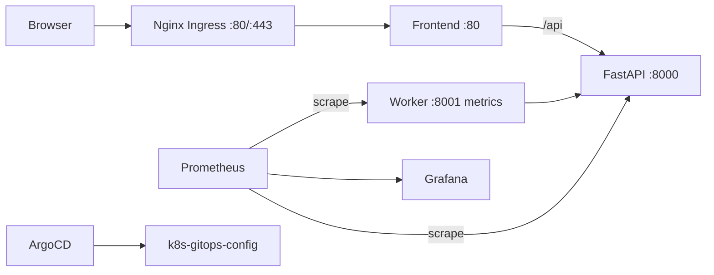

# Task Manager GitOps Platform

Three-service Python 3.12 demo deployed to kind with Argo CD and to AWS EKS with Terraform. The companion repositories are `Aditya-7788/k8s-ansible-config` and `Aditya-7788/k8s-gitops-config`.

## Architecture



See [docs/architecture.md](docs/architecture.md), [docs/gitops-flow.md](docs/gitops-flow.md), and [docs/monitoring-runbook.md](docs/monitoring-runbook.md).

## Quick start (Ubuntu 24.04)

From this repository root:

```bash
kind create cluster --name gitops --config kind/kind-config.yaml
bash scripts/build-and-load.sh
```

Before bootstrap applies the Argo CD root app, create the `monitoring` namespace and Alertmanager Secret using the manual instructions in the GitOps config repository README.

```bash
bash scripts/bootstrap.sh
```

Add `127.0.0.1 tasks.local` to `/etc/hosts`, then open `http://tasks.local:9080`. The ingress node ports are mapped to host ports 9080 and 9443. Argo CD deploys the staging environment from `Aditya-7788/k8s-gitops-config`; the repository must be public or configured with repository credentials in Argo CD.

Local-only image names are `frontend:v1.0.0`, `api:v1.0.0`, and `worker:v1.0.0`. Build and load after changing application source. `imagePullPolicy: IfNotPresent` lets kind use the loaded images.

For later releases, set a unique tag with `IMAGE_TAG=v1.0.1 bash scripts/build-and-load.sh` and update the matching image tags in GitOps environment values.

Run the app without Kubernetes using `docker compose up --build` and browse to `http://localhost:9080`.

## GitOps and monitoring

Argo CD watches the config repository. The root app discovers six staging/production service Applications, whose Helm releases install the workloads. Push a source change, rebuild/tag/load the image for kind, update the desired image tag in GitOps config, then observe Argo CD sync and Grafana. Dashboards are provisioned from labeled ConfigMaps. See [docs/deployment-guide.md](docs/deployment-guide.md) for the full flow.

The app stores tasks in memory; it is an observability and deployment demo, not a durable task database. No credentials are committed. Create the Alertmanager Slack webhook Secret manually as described in the GitOps repository README.

Demo video: `https://example.com/replace-with-demo-video`

## AWS EKS

The Terraform under `terraform/` provisions a VPC, EKS control plane, and managed node group. Review its README and estimated costs before applying. Terraform has not been applied.
