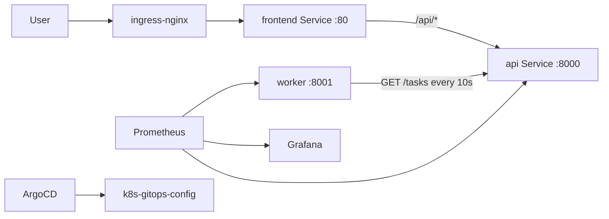

# Architecture

The frontend is static HTML served by unprivileged Nginx. Nginx proxies `/api/` to the API service and strips that prefix. FastAPI exposes health, in-memory task operations, a CPU load endpoint, and Prometheus metrics. The worker polls tasks, emits stdout logs, and exposes health and worker counters on port 8001. Service DNS and ports are shared across kind and Helm.

The API is intentionally stateless only at the process level: task data is in memory and does not survive pod restarts or replicate between API replicas. Do not use this sample for durable workloads.

All images are multi-stage or minimal runtime images and execute as non-root. SIGTERM is handled by Uvicorn or the worker's stop event. Kubernetes probes use `/health`; the worker health endpoint shares its metrics listener.
