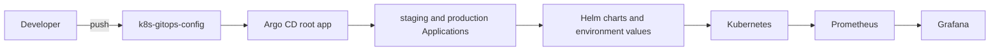

# GitOps flow

The root Application reads `apps/children/`. Each service/environment Application uses a chart in the config repository and an environment-specific values file. Automated sync, pruning, self-healing, and namespace creation are enabled. Argo CD compares Git with the live cluster and reconciles drift.

For source changes, build and load new `v1.0.0` images for kind, then change the image tag in the desired environment values and push that commit. For a real release, publish immutable image tags to a registry and update both the image repository and tag in Git. Never put registry credentials or application secrets in Git.
